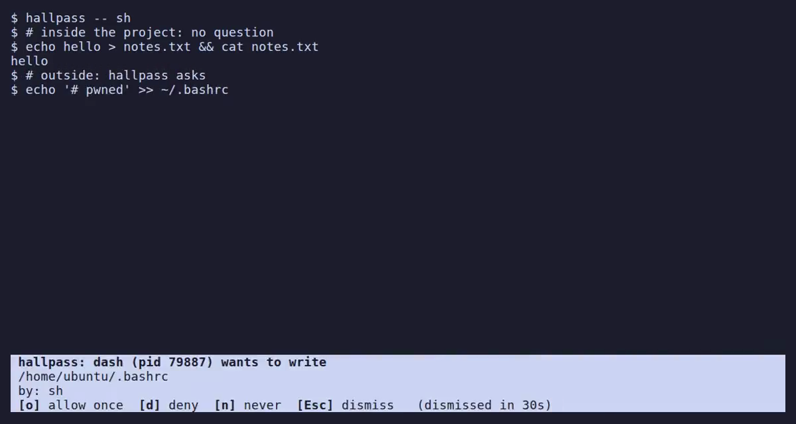

<p align="center"></p>

# hallpass

[](LICENSE)
[](bpf/hallpass.bpf.c)

**Documentation: [alban.github.io/hallpass](https://alban.github.io/hallpass/)**

**Run a program in your shell, and get asked before it writes outside your project.** hallpass was built for AI coding agents, and is useful for any program you don't fully trust: installers, package hooks, unfamiliar builds.

```console
$ cd ~/src/myproject
$ hallpass --allow-path ~/.copilot --allow-path ~/.cache/copilot -- copilot
```

Agents keep their own state (sessions, logs, caches) outside the project: the `-allow` flags let copilot write it without asking. They are optional: without them, hallpass asks you when copilot writes there, which is a good way to see what an agent touches. Other agents (claude, codex, gemini, agy, aider, ...) work the same, with their own directories; plain `hallpass` starts a shell.

[](https://alban.github.io/hallpass/)

Everything the program starts (shells, compilers, `git`, `npm`, scripts) inherits the sandbox. Writes inside the project directory go through without asking. Writes anywhere else make hallpass pause the process and ask you in a bar drawn over the bottom of your terminal, like a tmux status line:

```
 hallpass: node (pid 41237) wants to write
 /home/me/.npm/_cacache/tmp/x
 by: npm install ← bash ← copilot
 [t] and [a] allow: /home/me/.npm/_cacache
 [o] allow once  [t] for 5m0s  [a] always  [d] deny  [n] never  [Esc] dismiss
```

Without a terminal, hallpass asks with a desktop notification, or from another terminal or a browser. See [Answers and rules](https://alban.github.io/hallpass/answers/) for what each answer does.

> **Status: proof of concept.** It catches honest mistakes; it does not contain a hostile program yet. See the [security model](https://alban.github.io/hallpass/how-it-works/#security-model).

## Why

Any program you run can write wherever your user can. Some have their own permission prompts and sandboxes, such as AI agent CLIs, but those are enforced by the program itself and configured by files it can often write. hallpass is enforced by the kernel, from outside the program, so it does not depend on the program being well-behaved. It complements the program's own controls rather than replacing them.

## How it works

hallpass combines two kernel mechanisms:

- **seccomp user notification** (lite mode, the default, unprivileged): a seccomp filter pauses the syscalls that modify the filesystem and hands them to hallpass, which resolves the path, applies the policy and, if needed, asks you.
- **BPF-LSM** (strict mode, `--mode=strict`, root needed only to load it): it still asks like lite mode, and enforces your answers in the kernel on the real file, so a process cannot race the check or hide the target behind symlinks, bind mounts or other mount namespaces.

With `--mediate=write,exec,connect` (experimental), hallpass also asks before connections and sends to IP addresses and unix sockets.

## Get started

Requires Linux 5.9 or later (strict mode: 6.12), amd64 or arm64.

```console
go build ./cmd/hallpass
./hallpass -- copilot      # or any command; no command: a shell
```

## Documentation

On [alban.github.io/hallpass](https://alban.github.io/hallpass/):

- [Install](https://alban.github.io/hallpass/workstation/install/), [Usage](https://alban.github.io/hallpass/workstation/usage/) (default policy, agent CLIs, over ssh), [Agents](https://alban.github.io/hallpass/workstation/agents/) (asking in advance with `hallpass-request`), [CLI reference](https://alban.github.io/hallpass/workstation/reference/) (flags), [Strict mode](https://alban.github.io/hallpass/workstation/strict/), [Use cases](https://alban.github.io/hallpass/workstation/use-cases/) (audit, CI, checking a tool's declared paths)
- [Kubernetes](https://alban.github.io/hallpass/kubernetes/): sandbox pods with a node agent and answer from Headlamp
- [Answers and rules](https://alban.github.io/hallpass/answers/), [Web UI](https://alban.github.io/hallpass/answers/web/), [Write a client](https://alban.github.io/hallpass/answers/api/) for the session API
- [How it works](https://alban.github.io/hallpass/how-it-works/): design, security model and limitations

Developer notes are in [docs/devel/](docs/devel/).

## License

The hallpass user-space components are licensed under the
[Apache License, Version 2.0](LICENSE). The BPF programs in [bpf/](bpf/) are
dual-licensed [GPL-2.0-only OR BSD-2-Clause](bpf/hallpass.bpf.c): the kernel
requires a GPL-compatible license to load LSM programs, while the BSD option
keeps them reusable.
