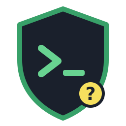
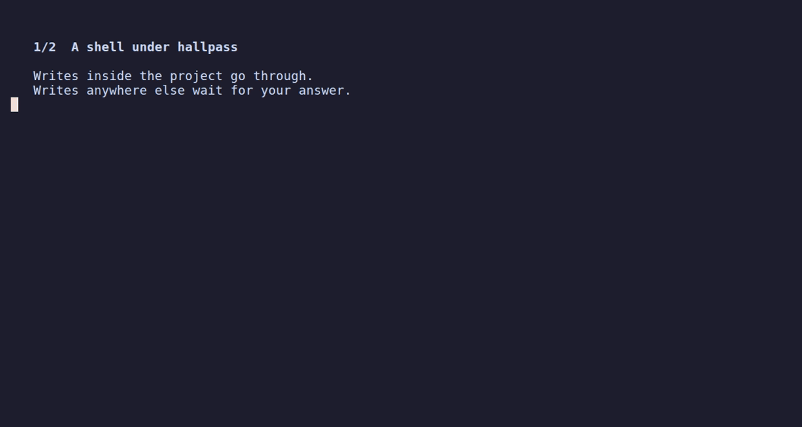

<p align="center"></p>

# hallpass

[](LICENSE)
[](bpf/hallpass.bpf.c)

**Documentation: [alban.github.io/hallpass](https://alban.github.io/hallpass/)**

**Run an AI coding agent in your shell, and get asked before it writes outside your project.**

```console
$ cd ~/src/myproject
$ hallpass -allow ~/.copilot -allow ~/.cache/copilot -- copilot
```

Agents keep their own state (sessions, logs, caches) outside the project: the `-allow` flags let copilot write it without asking. They are optional: without them, hallpass asks you when copilot writes there, which is a good way to see what an agent touches. Other agents (claude, codex, gemini, agy, aider, ...) work the same, with their own directories; plain `hallpass` starts a shell.



Everything the agent starts (shells, compilers, `git`, `npm`, scripts) inherits the sandbox. Writes inside the project directory go through without asking. Writes anywhere else make hallpass pause the process and ask you in a bar drawn over the bottom of your terminal, like a tmux status line:

```
 hallpass: node (pid 41237) wants to write
 /home/me/.npm/_cacache/tmp/x
 by: npm install ← bash ← copilot
 [t] and [a] allow: /home/me/.npm
 [o] allow once  [t] for 5m0s  [a] always  [d] deny  [n] never  [Esc] dismiss
```

| Key | Effect |
|-----|--------|
| `o` | allow this access |
| `t` | allow the scope (usually a folder) for 5 minutes |
| `a` | allow the scope for the rest of the session |
| `d` | deny this access; a retry asks again |
| `n` | deny this path for the rest of the session, without asking again |
| `Esc` | dismiss: deny, ask again next time |

The `by:` line shows the command line of the process and the commands it was started from, up to the agent. The process can change both, so they help you understand the request but prove nothing.

The desktop notification has room for three buttons only: Allow once, Allow 5 min and Deny (or Allow once, Deny and Never when there is no folder to offer).

Processes of the sandbox may write each other's `/proc/<pid>` files (agents tune `oom_score_adj`, for example). Writing those of a process outside the sandbox is asked about, and `t`/`a`/`n` then apply to that file for every process with the same command name.

The agent runs on a pseudo-terminal that hallpass relays, so the agent cannot see or answer the question. Output from the agent and its background jobs keeps showing above the bar, and when you answer, your terminal ends up exactly as if the bar had never been there. Keys typed in the first half second are ignored, so typing meant for the agent does not answer by accident. Without a terminal, hallpass asks with a desktop notification instead.

Writes to secret stores (`~/.ssh`, `~/.gnupg`, `~/.aws`, `~/.azure`, `~/.config/gh`, `~/.kube`, `~/.docker`, `~/.netrc`, `~/.git-credentials`) are asked about like any other write, but the prompt is flagged in red (for example "SSH keys — secret store"), so allowing one is a deliberate choice rather than a reflex. They are not denied outright: writing them is sometimes legitimate (`ssh-keygen`, `gh auth login`, `aws configure`), and a silent deny would hide the attempt instead of surfacing it.

> **Status: proof of concept.** Lite mode is best effort, not a security boundary; strict mode (BPF-LSM) enforces in the kernel. See [Limitations](#limitations).

## Why

Agent CLIs have their own permission prompts and sandboxes, but those are enforced by the agent process itself and configured by files the agent can often write. hallpass is enforced by the kernel, from outside the agent, so it does not depend on the agent being well-behaved. It complements the agent's own controls rather than replacing them.

## How it works

hallpass combines two kernel mechanisms:

- **seccomp user notification** (lite mode, unprivileged): a seccomp filter pauses the syscalls that modify the filesystem and hands them to the hallpass supervisor, which resolves the path, applies the policy and, if needed, asks you. This is what lets hallpass *ask* instead of just failing the call.
- **BPF-LSM** (strict mode, root needed only to load it): an eBPF program on the kernel's LSM hooks enforces the same policy on the real file (inode), so it cannot be bypassed by symlink races, bind mounts, other mount namespaces or `io_uring`. Your answers to the prompts are pushed to the kernel before the paused syscall continues.

Prompts are designed not to flood you: one notification per session, updated in place; identical pending requests (for example from `make -j`) are coalesced; and an "allow for 5 minutes" or "always" answer settles every pending request under that folder.

More detail: [docs/design.md](docs/design.md).

## Usage

```
hallpass [flags] [--] [command [args...]]     # default command: $SHELL

  -C, --workdir DIR        project dir, writable without asking (default: cwd)
      --allow PATH         also writable without asking (repeatable)
      --deny PATH          always denied (repeatable, wins over --allow)
      --ask MODE           auto | term | desktop | answer | deny   (default: auto = term if on a terminal, else desktop, else answer)
      --timeout DUR        unanswered prompt is denied after DUR (default 30s; 0 = wait forever)
      --allow-userns       let the sandbox create user/mount namespaces (weakens lite mode; always on in strict mode)
      --log FILE           append one JSON line per mediated syscall to FILE
      --mode MODE          lite (default, no root) | strict (BPF-LSM enforcement)
      --escalate TOOL      strict mode as a regular user: how to run the loader as root:
                           auto | ask | pkexec | sudo | run0 | doas | su | manual | none
                           (default: saved choice, else ask on a terminal, else auto)

hallpass policy [flags]                       # print the rules these flags give, then exit
```

By default, only `~/.config/hallpass` is denied (the sandbox must not change what hallpass runs next time); the project, a private `$TMPDIR` for the session (removed at exit if empty) and the usual `/dev` nodes are writable; anything else is asked, including the shared `/tmp`, `/var/tmp` and `/dev/shm` (answer "always" to allow them). Writes to known secret stores (`~/.ssh`, `~/.gnupg`, `~/.aws`, `~/.azure`, `~/.config/gh`, `~/.kube`, `~/.docker`, `~/.netrc`, `~/.git-credentials`) are asked too, with a red warning label. Press Ctrl-] inside a session to see its current rules, including answers given so far; any key closes the overlay.

### Strict mode

Strict mode still pauses writes and asks you interactively like lite mode, and the workload waits for your answer; the BPF-LSM program is an added layer that enforces each answer in the kernel on the real file, not a silent pre-configured policy.

Run hallpass as your user; only loading the BPF programs needs root:

```console
hallpass --mode=strict -- copilot
```

hallpass starts a short-lived copy of itself as root (`--escalate`: `auto` picks pkexec in a graphical session, else sudo, run0 or doas; `manual` prints the command for you to run as root and waits for Enter). Without `--escalate`, hallpass uses the choice saved in `~/.config/hallpass/config` (`escalate = sudo`), or else asks on the terminal which tool to use and whether to remember it; `--escalate=ask` asks again. The sandbox can never write `~/.config/hallpass`. The helper checks it was started for a hallpass of the invoking user, loads and attaches the programs, hands their file descriptors back to the supervisor and exits. The supervisor makes itself non-dumpable, and the LSM denies signals from the sandbox to it.

See [docs/usage.md](docs/usage.md).

## Using hallpass with agent CLIs

Wrap the top-level command; there is nothing to configure in the agent:

```console
hallpass -- copilot
hallpass -- claude
hallpass -C ~/src/app -- codex
```

Things to know:

- **Full-screen TUIs**: hallpass draws its question over the agent's screen and repaints it afterwards; the agent's terminal is never resized. This also works over ssh. Without a terminal, use the desktop prompt or `hallpass answer` from another terminal ([docs/usage.md](docs/usage.md#over-ssh)).
- **Agents' own sandboxes**: some agents run commands inside their own bubblewrap sandbox (for example Codex), which creates user and mount namespaces. hallpass lite mode blocks new namespaces by default, because inside a private mount namespace a process could bind-mount a protected directory somewhere that looks harmless. The agent's own sandbox will then fail to start or fall back; disable it in the agent, pass `--allow-userns` and accept the weaker lite-mode guarantees, or use strict mode, which allows namespaces because it checks real inodes.
- **Agents that use seccomp user notification themselves** cannot install their own listener under hallpass: the kernel allows only one listener per filter chain and returns `EBUSY`. This fails closed.
- **sudo** does not work inside the sandbox (`no_new_privs`), in either mode, by design.

## Requirements

- Linux with seccomp user notification (5.0+; `SECCOMP_USER_NOTIF_FLAG_CONTINUE` needs 5.5+). Check `/proc/sys/kernel/seccomp/actions_avail` contains `user_notif`.
- arm64 or amd64.
- Strict mode: BPF-LSM active, i.e. `bpf` listed in `/sys/kernel/security/lsm`. Fedora enables it by default; Ubuntu builds it but does not activate it (add `bpf` to the `lsm=` kernel parameter). The programs also need the `bpf_preempt_disable` kfunc (upstream 6.10); the verifier rejects them otherwise. Tested on 7.2.
- Desktop prompts: a session D-Bus with an `org.freedesktop.Notifications` service supporting actions (GNOME, KDE, most notification daemons).

## Building

```console
go build ./cmd/hallpass
```

## Limitations

hallpass is a proof of concept. It mediates filesystem writes; it does not yet mediate
`execve` or `connect`, in either mode. A sandboxed process can therefore reach
a service that acts on its behalf *outside* the sandbox, and so write anywhere
that service can, without a prompt. For example `systemd-run --user`, or
`docker`/`podman run` talking to a daemon, or a process connecting directly to
the systemd or D-Bus session socket. These are trivial, known escapes until
`connect`/`execve` policy exists; treat the current build as "ask me about
honest mistakes", not "contain a hostile agent".

Lite mode is best effort:

- Only writes are mediated (write-intent `open`, create, delete, rename, link, `truncate`, `mknod`). Reading secrets is not blocked in lite mode.
- Allowed syscalls continue with `SECCOMP_USER_NOTIF_FLAG_CONTINUE`, so a malicious multi-threaded process can change the path between the check and the kernel acting on it (TOCTOU). Strict mode (BPF-LSM) closes this.
- Pre-existing hard links to protected files are not detected.
- `chmod`, `chown`, extended attributes and timestamps are not mediated yet.
- Network and `execve` policy are not implemented yet (see above).

Strict mode:

- The supervisor holds writable fds of the BPF maps, so the user running hallpass can put any process, including other users', under the policy or under signal protection. Choosing an escalation tool is the administrator's consent to that.
- If the supervisor dies, the programs are detached. Seccomp then fails the sandbox's mediated syscalls closed, but nothing else is enforced on processes left behind.
- With `--escalate=manual` from a root shell, the helper cannot tell which user invoked it and only checks that the target runs the same hallpass binary.
- `kernel.yama.ptrace_scope=3` prevents the helper from fetching the socket (`pidfd_getfd`); run hallpass as root instead.

## License

The hallpass user-space components are licensed under the
[Apache License, Version 2.0](LICENSE). The BPF programs in [bpf/](bpf/) are
dual-licensed [GPL-2.0-only OR BSD-2-Clause](bpf/hallpass.bpf.c): the kernel
requires a GPL-compatible license to load LSM programs, while the BSD option
keeps them reusable.
