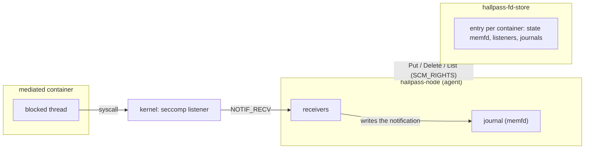
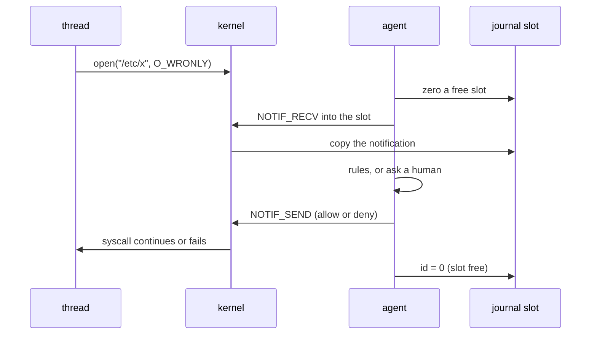
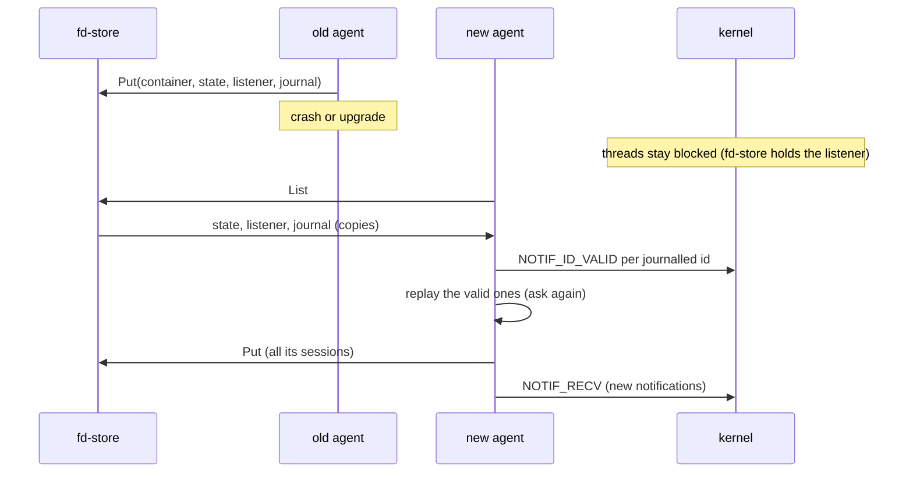

# Kubernetes

Status: work item 1 (lite mode) implemented on branch `nri`; the cluster
API (option A) and the Headlamp plugin on branch `headlamp`; strict mode
on branch `strict-k8s`. See the implementation notes ([work item
1](#implementation-notes-work-item-1),
[Headlamp](#implementation-notes-headlamp), [strict
mode](#implementation-notes-strict-mode)) for where they differ from
this design. User docs: [../kubernetes/](../kubernetes/index.md).

Run AI agents in pods under hallpass, opted in per namespace and per pod,
and answer their requests from [Headlamp](https://headlamp.dev), in
strict mode (BPF-LSM) on nodes where it is active, else in lite mode.

## Components

```
kubelet ──CRI──> containerd ──NRI──> hallpass-node (DaemonSet, one per node)
                     │                  ▲     gRPC session API on 127.0.0.1
                     └─runc─ seccomp fd ┘     (pod network, not hostNetwork)
                                                 ▲
 Headlamp plugin ──> kube-apiserver ──port-forward┘   (option A, chosen)
```

- **`hallpass-node`**, a DaemonSet, one process per node:
  - an **NRI plugin**: on `CreateContainer`, for opted-in pods, adds a
    seccomp policy that notifies hallpass's syscalls, with
    `listenerPath` set to its agent socket;
  - a **seccomp agent**: runc connects to `listenerPath` when it starts
    the container and sends the notify fd and the container state
    (pid, annotations) with `SCM_RIGHTS`, per the OCI seccomp agent
    protocol. The agent runs one `monitor.Monitor` per container;
  - the **session API** (`internal/sessionapi`), one gRPC server for all
    the node's sessions, each identified by pod, container and id.
- **Headlamp plugin**: Pending, Activity and Rules views (as in
  [web.md](web.md#views)), plus a "hallpass" section in the pod details
  page. It speaks gRPC to the agents over port-forward (option A).
- A separate binary, `cmd/hallpass-node`: client-go and NRI stay out of
  the `hallpass` binary.

## Requirements (checked)

- containerd 2.2 or later: it ships NRI v0.10, which added
  `ContainerAdjustment.SetLinuxSeccompPolicy` with `listener_path` and
  `listener_metadata` (containerd/nri b315f77). NRI is on by default in
  containerd 2.x. CRI-O: to check.
- runc 1.5 or later accepts `SECCOMP_FILTER_FLAG_WAIT_KILLABLE_RECV` in
  the OCI `flags`, which hallpass uses today. It is not silent: an older
  runc (unknown flag), libseccomp < 2.6 or kernel < 5.19 make runc fail
  the container creation (`seccomp.FlagSupported`). The agent sets the
  flag only if the kernel supports it and `runc features` (run from the
  host root) lists it.
- No fallback for containerd without NRI (a `localhost/` profile from
  the node cannot carry a `listenerPath` set per container): such nodes
  are not supported.
- The NRI default validator can reject seccomp adjustments
  (`reject_custom_seccomp_adjustment`, ...): the cluster admin must allow
  them, at least for this plugin.

## Opt-in

A container is mediated only if both hold:

1. its namespace matches the node agent's `--namespace-selector`, a
   label selector set by the cluster admin in the DaemonSet (as
   `namespaceSelector` in admission webhooks; e.g.
   `hallpass.io/enabled=true`), checked with a namespace informer; and
2. the pod has the annotation `hallpass.io/policy: <name>`, naming a
   policy (see below).

Every other container is untouched: the plugin returns no adjustment.
The annotation alone is not enough, so a user who can create pods cannot
put hallpass in front of a namespace the admin did not choose; the
allowlist alone is not enough, so nothing changes for existing pods of an
allowed namespace.

## Strict mode

The DaemonSet already runs privileged, so it can load the BPF-LSM
programs itself (no root helper) where `bpf` is in the active LSMs.

The programs must be loaded once per node, not once per container: each
copy runs on every hook of every task on the host. Today one `lsm.LSM`
is one session: members are marked `1` in task storage and `Sync`
replaces the whole rule set. The node agent needs a session id in them:

- the member mark holds the session id (inherited on fork as today);
- rule and grant keys include it; `Sync` replaces one session's rules;
- ring buffer events carry it, and the agent routes them to the right
  monitor.

`monitor.Kernel` then becomes a per-session view of the shared `LSM`.

The first exec is the barrier: the container's first `execve` is
notified, so the agent marks the task as a member when it handles that
notification, before the container's binary runs. Not on `Attach`: the
init process is still runc's then, and it reopens its exec fifo for
writing, which the session's rules would deny.

Paths: `bpf_path_d_path` resolves from the task's root, so rule paths
are container paths already; `Sync` resolves them to inodes through
`/proc/<pid>/root`, like lite mode.

## Seccomp policy

The OCI profile is generated from hallpass's rule table
(`internal/seccomp`), so the cluster and the CLI mediate the same
syscalls:

- `Notify` rules become `SCMP_ACT_NOTIFY`.
- `NotifyIfWrite` (open, openat with a write flag) becomes one
  `SCMP_ACT_NOTIFY` rule per flag bit (`SCMP_CMP_MASKED_EQ`, bit, bit),
  since OCI ORs the rules of a syscall.
- `Errno` and `ErrnoIfNamespace` become `SCMP_ACT_ERRNO` rules, as in
  the runtime's default profile.

They are merged into the container's existing policy (`RuntimeDefault`,
`Localhost`, or none): hallpass's rules come first, the rest is kept. An
`Unconfined` pod gets `defaultAction: SCMP_ACT_ALLOW` plus hallpass's
rules.

## Paths

Lite mode resolves a path in the monitor's own view of the filesystem
(`procfs.Resolve`). The node agent (`hostPID`) resolves it through the
calling process's root, `/proc/<pid>/root/`: the per-process root, so a
chroot inside the container is handled too. Going through that prefix is
not enough on its own: the kernel follows an absolute symlink, or a `..`
at the top, from the agent's root, not the container's. `walk` already
resolves symlinks one component at a time; it gets a root to prefix and
to clamp absolute targets and `..` to. Rules and prompts use container
paths (`/workspace/x`, not `/run/containerd/.../rootfs/workspace/x`).

Work: a root parameter in `procfs.Resolve` and `walk` (the CLI passes
`/`); the "other mount namespace" check in the monitor compares with that
root instead of the monitor's.

## Policies

A `HallpassPolicy` (cluster-scoped, created by the admin) holds what the
CLI takes from its flags and config file:

```yaml
apiVersion: hallpass.io/v1alpha1
kind: HallpassPolicy
metadata:
  name: agent
spec:
  allow: [/workspace/**, /tmp/**, /home/agent/.cache/**]
  deny: [/var/run/secrets/**]
  ask: true            # false: deny without asking (audit-only pods)
  askTimeout: 5m       # no answer in time: deny
```

## Cluster API

Both options sit on the same agent and gRPC session API; only the last
hop differs, so one can be added after the other. **Decided: A**, as
Inspektor Gadget does; no CRDs for requests. B stays an option if
per-namespace RBAC or the audit log become necessary.

### A. gRPC over port-forward (as Inspektor Gadget's Headlamp plugin)

The plugin opens a port-forward (WebSocket through the API server and
the kubelet) to each agent pod and speaks gRPC over it, with a Go client
compiled to wasm.

- Reuses the session API as is; Activity is a live stream; nothing is
  stored in the API server.
- The agent listens on 127.0.0.1 in its pod network: other pods cannot
  reach it.
- Authorization is coarse: whoever may `create pods/portforward` on the
  agent pods answers for every namespace. Answers are in the agent's
  log, not in the API audit log.
- One stream per node per open Headlamp tab.

### B. CRDs

The agent mirrors its monitors into the API server and applies the
answers it reads back.

- **`HallpassSession`** (one per mediated container, owned by the pod,
  deleted with it): `status` has the pod, container, node, start time,
  the rules (with their sets and expiry), and the last 200 `Decided`
  events, written at most every few seconds.
- **`HallpassRequest`** (one per pending request, owned by the session):
  `spec` has the op, objects, subject chain, facts, and the prompt
  (text and choices) from the `Answer` RPC's mapping; `status.answer` is
  set by the user (once, temp, always, never, deny). The agent applies
  it, then deletes the request. A request whose syscall ended (the
  process died, another answer won) is deleted too.
- Removing a rule: an annotation on the session
  (`hallpass.io/remove-rule: <id>`).

In the workload's namespace, so RBAC delegates per namespace and owner
references clean up with the pod. The roles for these resources must not
be aggregated into `edit`/`admin`, or a workload with a broad service
account could answer for itself.

- Kubernetes RBAC per namespace, audit log, `kubectl get
  hallpassrequests -w`.
- Load: requests exist only while a thread waits for a human, so a few
  per session; fine for etcd. `Decided` events (thousands per second)
  must not become objects: only a capped, throttled list. A cap on
  pending requests per session stops a sandbox from flooding the API
  server with blocked threads.
- A request takes an API round trip (tens of ms) before it is shown.

## Headlamp plugin

Both a dedicated view and additions to the pod pages.

- Sidebar entry and route: pending requests across the cluster, the
  activity and the rules (the three views of `hallpass web`, in React).
- App bar badge (`registerAppBarAction`): the number of pending
  requests. A blocked workload waits on an answer: it must show on any
  page.
- Pod details section (`registerDetailsViewSection`): whether hallpass
  is on, the policy, the pod's pending requests and rules, answerable
  in place.
- Pod header action (`registerDetailsViewHeaderAction`): "Sandbox with
  hallpass". The filter is installed when the container is created, so
  it patches the owner's (Deployment...) pod template annotation and
  causes a rollout; it cannot apply to a running pod.
- Pod list column (`registerResourceTableColumnsProcessor`): pending
  count.

## Idea: substitute a file's content (to discuss, not planned)

Use case: deploy a container with one config file changed, without
rebuilding the image. A rule names a path and a content; an `openat` of
that path gets a memfd holding the content.

Lite mode can do it: the agent fills a memfd and makes it the result of
the syscall with `SECCOMP_IOCTL_NOTIF_ADDFD` and
`SECCOMP_ADDFD_FLAG_SEND`, atomically. To discuss:

- For a content fixed at deploy time, an NRI bind mount over the file
  at container creation is simpler: it also covers `stat`, `mmap` and
  `exec`, and costs nothing at run time. A memfd only wins for dynamic
  cases (content changed at run time, per process, per open).
- Cost: the filter traps writes today. Substituting reads means trapping
  every `openat` (seccomp cannot match paths), in the containers that
  have such a rule only.
- Leaks: `stat(path)` still shows the original size and inode,
  `/proc/self/fd/N` shows `memfd:`. Some programs read `st_size` bytes.
- Opens for writing: a sealed read-only copy, or a private writable one?
- Lite mode only: BPF-LSM can deny, not substitute.
- Who may set it: injecting content is a privilege beyond allow or deny
  (annotation or CRD, RBAC).

## Lifetime

- The notify fds live in the agent, with copies in `hallpass-fd-store`
  (below): the agent can crash or be upgraded, the next one takes the
  sessions over. Without fd-store (`--fd-store=""`), the mediated
  syscalls of running containers fail with `ENOSYS` when the agent dies.
  Both DaemonSets are `updateStrategy: OnDelete`.
- If the agent is not running when a container starts, its NRI plugin is
  not registered (the registration lives as long as its connection to
  containerd), so the container starts without hallpass: open by
  default. To fail closed, the admin lists the plugin in the NRI default
  validator's `required_plugins`, or the pod requests it with the
  `required-plugins.noderesource.dev` annotation (e.g. `[hallpass]`). The plugin cannot add that
  annotation: it is set when the pod is created (a mutating admission
  webhook could add it to every opted-in pod).
- Between the plugin's adjustment and runc's start, an agent that died
  makes runc fail to connect to `listenerPath`: that container fails to
  start.
- Restarting a container gives a new session.

## fd-store

A separate DaemonSet, `hallpass-fd-store` (`updateStrategy: OnDelete`,
rarely updated), keeps the agent's file descriptors across agent crashes
and upgrades, so the running containers stay mediated. It is generic and
has no Kubernetes client: `Put(key, fds, blob)`, `Delete(key)`, `List`
over SCM_RIGHTS on a root-only socket in `/run/hallpass`, keyed by
container id. Strict mode adds its BPF object fds (no pinning).

Per listener (a container's, or a `kubectl exec`'s) it holds the seccomp
listener and a memfd, the journal of its in-flight notifications; per
container, the session's rules as the blob.



Both processes hold a copy of each fd: the listener is closed (and the
waiting threads get `ENOSYS`) only if both die.

A notification's life in the agent:



An agent restart:



**Why a journal.** `SECCOMP_IOCTL_NOTIF_RECV` returns only notifications
not yet received, and marks them received (`kernel/seccomp.c`,
`seccomp_notify_recv`); nothing lists the received ones. While a copy of
the listener stays open, their threads stay blocked (no `ENOSYS`), so
the new agent must answer them, and only knows them from the journal.
`NOTIF_SEND` and `NOTIF_ID_VALID` work from any copy of the fd.

**Receiving and waiting.** A fixed set of receivers per listener
(`max(4, NumCPU)`) receive, decide and answer each notification
themselves; only a notification that needs a human moves to its own
goroutine. Deciding on the receiving thread keeps the ping-pong with the
blocked thread on one CPU: the listener asks the kernel for synchronous
wakeups (`SECCOMP_USER_NOTIF_FD_SYNC_WAKE_UP`, Linux 6.6+), and a
goroutine per notification moved the answer to another thread, often
another CPU. Together, they cut `rm -rf` of 20k files in lite mode from
8.4 s to 2.95 s on Fedora. A request waiting for a human then holds a goroutine and a
slot, not a receiver: before, each worker handled one notification at a
time, so a few unanswered questions (or `make -j16` threads waiting on
one coalesced question) stopped every mediated syscall of the
container, even those the rules allow. In-flight notifications are
capped per listener (1024 by default, `--max-inflight` for
`hallpass-node`): each is a blocked thread of the workload, so the cap
is about the workload, not the machine. At the cap, the receivers wait
for a free slot and the kernel queues the rest. The CLI has the same
split and cap, with its journal on the Go heap: nothing could recover
it, its notifications fail with `ENOSYS` when it dies.

**Slots.** A slot is 80 bytes, a `struct seccomp_notif`; free slots are
in a list, and a slot belongs to one goroutine from its receive to its
answer. The receiver:

1. takes a free slot and zeroes it;
2. calls `NOTIF_RECV` with the slot as buffer, so the kernel writes the
   notification into the journal before the ioctl returns (no gap
   between received and journalled; a SIGKILL takes effect only after
   the copy);
3. handles it (or hands it to a new goroutine if it asks a human), sends
   the answer and clears the slot with one atomic 64-bit store of
   `id = 0` (offset 0, aligned; the other bytes are ignored when `id`
   is 0).

A partial copy (`EFAULT`) could leave a real id with a truncated rest,
while the kernel hands that notification to another receiver. It is
made impossible rather than handled: no slot crosses a page, and the
whole journal is allocated when the listener is attached (`ftruncate`,
`F_SEAL_SHRINK`/`F_SEAL_GROW`, `MADV_POPULATE_WRITE`, `mlock`), so the
copy cannot fault. An allocation failure fails the attach: the container
does not start. 1024 slots are 21 pages (84 KiB) of locked memory,
charged to the agent's memory cgroup.

**Recovery.** The new agent gets the listener and the memfd back, and
for each slot with a non-zero id: `NOTIF_ID_VALID` fails → answered or
the thread died, clear it; otherwise handle it again (the thread is
blocked, so its pid and `/proc/<pid>/mem` are unchanged; a question
reappears). The same id in two slots should not happen: warn and replay
one (a second `NOTIF_SEND` gets `EINPROGRESS`). A crash after the answer
and before the clear is harmless: `NOTIF_ID_VALID` fails.

**Rules.** The session's rules (`always`/`temp` answers) are the
container's blob: the agent `Put`s them again on each change (rare,
human), and fd-store replaces them at once.

**Failures.** fd-store alone crashing loses nothing (the agent holds
its copies) and gets them again when it is back. Both crashing: the
waiting threads fail with `ENOSYS`, as without fd-store. Upgrading
fd-store is a restart of fd-store alone, while the agent runs; the
protocol between versions must stay compatible (not versioned yet).

**Implementation.** `internal/fdstore`: a `SOCK_SEQPACKET` socket
(`/run/hallpass/fd-store.sock`, directory 0700, peer uid checked with
`SO_PEERCRED`); each message is a JSON header (`put`, `delete`, `list`,
`end`, `reply`) with the fds as `SCM_RIGHTS`. `put` replaces an entry
and closes its old fds; `list` sends copies, entries stay. An entry is
keyed by container id; its fds are a sealed memfd with the session
state as JSON (start, metadata, policy, rules, pids), then a listener
and its journal per listener.

The agent (`cmd/hallpass-node/store.go`) connects before serving its
listener socket,
then checks the connection every second and reconnects. On each
connection it lists the entries, adopts those it does not know, then
`Put`s all its sessions again (that also refills a restarted fd-store).
Adopting restores the session with its saved policy (not re-read: the
caches may not be synced yet) and its unexpired rules, and attaches
each listener with its journal, which replays the in-flight
notifications. Request ids restart from 1 and ask timers restart.
Stale entries heal themselves: a listener whose container is gone hangs
up, and the session's end `Delete`s the entry. The agent `Put`s after a
session starts, after each new or ended listener and after each rule
change; `AttachJournal` returns a channel closed when the listener hangs
up, then the agent closes its copies.

## Privileges

`hallpass-node` runs privileged with `hostPID` (it reads
`/proc/<pid>/{mem,root,cwd,fd}` of containers on its node) and mounts
`/var/run/nri` and its socket directory (`/run/hallpass`) from the host.
Its service account reads namespaces (for the selector), pods, and
`hallpasspolicies`.

## Testing

kind with a node image running containerd 2.2, NRI enabled, and the
default validator allowing seccomp adjustments; an e2e test creates a
pod writing outside `/workspace`, answers its request over the session
API (port-forward), and checks the write and the session's rules. The
same test answers through Headlamp with the plugin, driven by a
headless browser.

## Work items (branches)

1. `nri`: root-aware `procfs.Resolve`; OCI profile from the rule table;
   `cmd/hallpass-node` (NRI plugin, seccomp agent, one session API for
   the node); `HallpassPolicy`; manifests; kind e2e. Lite mode.
2. `strict-k8s`: strict mode on the node, one BPF load with session ids.
3. `headlamp`: the cluster API (A) and the plugin (`headlamp/`).
4. `fd-store`: keep the listeners across agent restarts.
5. Later: CRI-O.

## Open questions

- Remove a rule: an annotation on the session (decided).
- The agent socket directory on the host: rely on its permissions
  (root-only, 0700), no peer check (decided).

## Implementation notes (work item 1)

Where `cmd/hallpass-node` (branch `nri`) differs from or adds to the
design above:

- **Paths.** `procfs.Resolve` takes a root (`procfs.Root`); the agent
  uses `/proc/<pid>/root` of the calling process and gets container
  paths back. It also checks that the directory it resolved from is the
  file the root names (`sameFile`): a detached mount (`fsopen`,
  `open_tree`) is named relative to its own root, so its name means
  nothing in the container and a clone could pass for an allowed path.
  Such opens are refused, except one case: runc 1.2+ reopens its exec
  FIFO through a detached procfs after loading the filter
  (`openat(<detached /proc/1/task/1/fd>, "7", O_WRONLY)`); a single
  component on a procfs directory whose magic link points to a FIFO or
  socket is reported as the special file `fifo:N`/`socket:N`, as
  `/proc/self/fd/N` already is.
- **Rules.** Policy paths are matched lexically (`defaults.NewLexical`):
  the agent does not resolve them in the container at start, since the
  container's root is not populated yet when the policy is built.
  Policy path syntax: `/x/**` or `/x` (the tree under `/x`); other globs
  and relative paths are rejected. `ask` defaults to true, `askTimeout`
  to 5m (must be positive).
- **Implicit allows** in a container: `defaults.DefaultAllows`
  (`/dev/null`, ...), `/dev/tty`, `/dev/pts` (the container's own
  devpts) and `/dev/termination-log`. No home or cache defaults.
- **Seccomp profile** (`internal/ociseccomp`): only the native
  architecture is kept (`architectures` of the original policy are
  dropped, as hallpass's rules use native syscall numbers). A container
  policy that already uses `SCMP_ACT_NOTIFY` (default action or any
  rule) or its own `listenerPath`, or that conditions a hallpass syscall
  in a way libseccomp cannot combine with hallpass's rule, is refused
  (container creation fails) rather than merged. `CLONE_NEWUSER` and
  `CLONE_NEWNS` are denied as with `--allow-userns=false`.
  `SECCOMP_FILTER_FLAG_WAIT_KILLABLE_RECV` is set with
  `--wait-killable=auto` only if the kernel accepts it and
  `runc features`, run chrooted in `/proc/1/root`, lists it (runc 1.4.3
  in kind does not).
- **Policies** come from the `HallpassPolicy` CRD through a dynamic
  informer. A pod naming a missing policy, or a namespace lookup error,
  fails the container creation (fail closed once opted in). If the
  policy is gone when runc connects, the session has only the implicit
  allows and does not ask.
- **Startup.** The informers start without blocking: the agent registers
  with NRI at once, and until both caches have synced the lookups fail
  with `errNotSynced`, so opted-in containers are refused rather than
  started unmediated (waiting for the caches before registering left that
  window open, e.g. when the agent restarts during an API server outage).
  `Synchronize` marks the plugin registered; the end of `stub.Run` clears
  it. Both together set the gRPC health service of the session API to
  SERVING, checked by the exec readiness probe `hallpass-node ready` (the
  API is on the pod's loopback, out of reach of an httpGet or grpc
  probe). No liveness probe: a restart drops the running containers'
  listeners.
- **Events.** Each session subscribes to its monitor's `Decided`
  events. An answer through `session.Answer` is one Event, with who
  answered; a denial of the agent itself while the policy asks is a
  timeout (`HallpassNotAnswered`); the other denials (rules, built-ins)
  are counted per container, the first reported at once, then a summary
  per minute (the count and the three most frequent "op path"), flushed
  when the session ends. The paths are untrusted: control characters are
  replaced and each path is cut at 200 bytes. client-go's correlator stays as
  a backstop against floods. Events need `create`/`patch` on `events`
  and `NODE_NAME` (the source host).
- **Sessions.** One per container id; `kubectl exec` (a new listener for
  the same container) attaches to the same monitor. A session ends when
  the monitor has no listener left. `listenerMetadata` is JSON
  `{namespace, pod, podUID, container, policy, home}`.
- **Session API.** One `sessionapi.Node` per node on `127.0.0.1:7323`.
  Backward compatible proto changes: a `List` RPC and `SessionInfo.id`;
  on the node agent, the other RPCs must select the session with the
  `hallpass-session` gRPC metadata key. The CLI's unix socket serves one
  session, ignores that key and keeps its peer checks; the agent's TCP
  listener has none.
- **Client.** `hallpass-node sessions|pending|answer --addr`, sessions
  named by id, id prefix or `namespace/pod/container`. Answers go
  through `internal/answer`, shared with `hallpass`.
- **RBAC.** Namespaces and `hallpasspolicies` (get, list, watch); pods
  are not read: the pod's labels and annotations come from NRI.
- **kind.** `kindest/node:v1.37.0` ships containerd 2.3.4 with NRI on
  and the default validator off, and runc 1.4.3: no node image changes.
  `make test-kind` (`test/kind/e2e.sh`) creates the cluster, deploys
  the agent and checks mediation, answers (once, deny) over
  port-forward, and that unselected pods are untouched.
- **Not done:** policy changes do not affect running sessions (strict
  mode and the fd-store came later, see below).

## Implementation notes (Headlamp)

Branch `headlamp`, on top of `nri`:

- **Wasm client** (`cmd/headlamp-wasm`, `GOOS=js`). The plugin reuses
  the Go client rather than a TypeScript gRPC client: `internal/nodeclient`
  holds the node agent's client side (dial, session selection, lookup)
  without the monitor, so it builds for wasm; `nodeclient.Watch` lists the
  sessions every 2 s, follows each one's events, and reports the whole
  state (sessions, pending requests, rules) as JSON after each change.
  3.4 MB gzipped, shipped as `main.wasm.gz` next to `main.js` and
  fetched from Headlamp's plugin URL.
- **Port-forward.** The plugin opens
  `/api/v1/namespaces/hallpass-system/pods/<pod>/portforward?ports=7323`
  with Headlamp's `stream()` (its auth and cluster proxy), with the
  `v4.channel.k8s.io` subprotocols. Go only gets `send` and `close`
  callbacks and is fed the received messages: it decodes the
  channel.k8s.io framing (data and error channels, each starting with
  the port) into a `net.Conn` for gRPC. A write waits for the data
  channel's port header. One WebSocket carries one TCP connection: if
  it ends, the plugin reconnects with a backoff (1 s, doubling, up to
  30 s).
- **Agents.** The plugin watches the pods
  `app.kubernetes.io/name=hallpass-node` in `hallpass-system` and keeps
  one connection per running pod, so per node, while a page of the
  cluster is open. A store per cluster holds their state; the React
  components read it with `useSyncExternalStore`. Exceptions in the
  callbacks Go calls are caught: they would stop the wasm program.
  The four methods given to JS for a connection (`deliver`, `closed`,
  `answer`, `close`) are created once, with `js.FuncOf`, and bound to the
  connection's id (`Function.prototype.bind`): a `js.Func` per
  connection would leak, since releasing one that JS still calls
  panics, and the plugin reconnects for as long as a page is open.
- **UI.** The sidebar view has the pending requests, the sessions and
  the agents' state; the app bar badge, the pod details section (policy,
  pending requests, rules per container) and the pod list column
  (`N pending` or `mediated`) read the same store. The answers are those
  of `hallpass-node answer`, sent with client name `headlamp`. Not done:
  the Activity view and removing rules.
- **Sandbox with hallpass.** Follows the pod's controllers (ReplicaSet to
  Deployment, Job to CronJob; StatefulSet, DaemonSet) and merge-patches
  the annotation on the pod template, or removes it. Bare pods and Jobs
  cannot change their template: the dialog says so. It warns when the
  namespace lacks `hallpass.io/enabled=true`, the default selector.
- **Authorization** is option A's: `create pods/portforward` on the
  agent pods answers for the whole cluster.
- **Tests.** `make test-headlamp`: tsc, lint and vitest (the store's
  reconnects and answers, the sandbox's owner lookup and patch);
  `go test ./cmd/headlamp-wasm` runs gRPC to a `sessionapi.Node` through a
  simulated port-forward. `make test-headlamp-kind` runs the kind e2e
  with `E2E_ANSWER=test/kind/headlamp/answer.sh`: Headlamp v0.46.0
  (pinned by digest) in docker with the plugin, driven by Puppeteer
  and Chromium; it checks the badge, the column, the section, answers
  `once` and `deny`, and sandboxes a Deployment. The npm lockfiles
  name `registry.npmjs.org`; npm fetches from the configured registry
  instead (`replace-registry-host`). `demos/headlamp/record.js`
  records the demo on the same cluster.

## Implementation notes (strict mode)

- **The node chooses the mode, not the policy.** `hallpass-node run
  --mode=auto|lite|strict` (default `auto`). The agent loads the BPF
  programs once at startup (`setupStrict`), protects its own pid from
  signals (global, for every session), and every new session is strict
  while they are loaded. `strict` fails to start without BPF-LSM;
  `lite` loads nothing, but keeps the programs adopted from the
  fd-store for the strict sessions it restores.
- **Session ids.** `lsm.LSM.NewSession(root)` gives a session id; the
  member mark, the rule and grant keys, and the ring buffer events carry
  it. One `lsm.Session` per container, shared by its `kubectl exec`
  listeners.
- **Members on execve only.** `monitor.attach` does not mark the root
  (it is still runc init, which reopens its exec fifo: `permission
  denied` otherwise); the agent marks each task on its notified
  `execve`, and children inherit the mark. `Attach` opens
  `/proc/<root>/mountinfo` to resync rules on mount changes.
- **Restarts.** The fd-store keeps the BPF object fds under
  `hallpass:lsm`, and each session's id in its blob. A new agent adopts
  the programs and calls `ResumeSession(id, root)`: the marks are still
  in task storage, so processes forked before the restart stay in the
  session (with a new id, `DropStale` would remove their rules). A
  listener whose root has exited is not restored: its mountinfo cannot
  be opened.
- **securityfs.** The kind node has none mounted under
  `/proc/1/root/sys/kernel/security`, so `lsm.ActiveIn` falls back to a
  detached securityfs mount of its own (`fsopen`/`fsmount`) to read
  `lsm`.
- **Tests.** `make test-vm` runs `TestRestartStrict` (vimto, BPF-LSM):
  the agent restarts while a forked subshell keeps writing. The kind
  e2e with `E2E_STRICT=1` requires `strict=true` sessions and runs the
  race pod (`test/kind/e2e-race.yaml`, `demos/strict/race`): no escape
  in thousands of tries, in the pod and through `kubectl exec`; in lite
  mode it escapes after a few dozen tries, logged only. GitHub runners
  have no BPF-LSM, so the strict kind run is manual, on a Fedora VM
  with podman, with everything built elsewhere:

  ```sh
  docker build -f deploy/kubernetes/Dockerfile -t hallpass-node:e2e .
  docker save -o hallpass-node.tar hallpass-node:e2e
  CGO_ENABLED=0 go build ./cmd/hallpass-node
  CGO_ENABLED=0 go build ./demos/strict/race
  # copy them, kind, kubectl, test/kind and deploy/kubernetes to the VM
  sudo env KIND_EXPERIMENTAL_PROVIDER=podman E2E_STRICT=1 \
    HALLPASS_NODE_ARCHIVE=$PWD/hallpass-node.tar \
    HALLPASS_NODE_CLIENT=$PWD/hallpass-node HALLPASS_RACE=$PWD/race \
    bash test/kind/e2e.sh
  ```
