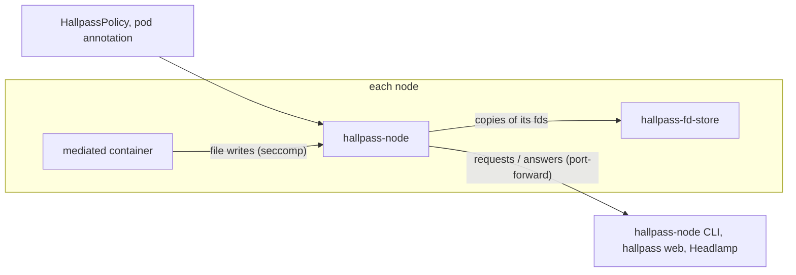

# Kubernetes

`hallpass-node` sandboxes workloads in pods (AI agents, for example)
with hallpass, in strict mode where the nodes have BPF-LSM, else in lite
mode (see [Strict mode](install.md#strict-mode)). It is a
DaemonSet: on each node, an
[NRI](https://github.com/containerd/nri) plugin adds a seccomp policy to
the containers that opt in, and a seccomp agent mediates their file
writes as `hallpass` does on a workstation. You answer their requests
through a gRPC session API on the agent pod, with the `hallpass-node`
client, `hallpass web` or the Headlamp plugin.

!!! warning
    Experimental.

- [Install and operate](install.md): for the cluster admin. Install,
  restarts and upgrades, failure modes, flags.
- [Opt in and policies](policies.md): which containers are mediated and
  what they may write.
- [Answer requests](answer.md): from the CLI, a browser or Headlamp;
  who may answer; logs and Events.

## Requirements

- containerd 2.2 or later, with NRI enabled (the default in containerd
  2.x). Check with `containerd config dump`: the
  `io.containerd.nri.v1.nri` plugin has `disable = false`.
- If the NRI default validator is enabled
  (`[plugins.'io.containerd.nri.v1.nri'.default_validator] enable = true`),
  it must not reject seccomp adjustments
  (`reject_unconfined_seccomp_adjustment`,
  `reject_runtime_default_seccomp_adjustment`,
  `reject_custom_seccomp_adjustment`).
- runc. With runc 1.5 or later and Linux 5.19 or later, the agent sets
  `SECCOMP_FILTER_FLAG_WAIT_KILLABLE_RECV`, so a signal does not
  interrupt a mediated syscall while it waits for an answer
  (`--wait-killable`, detected with `runc features`).
- CRI-O and nodes without NRI are not supported.
- Strict mode: Linux 6.12 or later, with `bpf` in the active LSMs (the
  `lsm=` kernel parameter), as on a
  [workstation](../workstation/strict.md).

## Limitations

- In lite mode, seccomp user notification is exposed to TOCTOU races
  (see [How it works](../design.md)); strict mode closes them.
- Containers created while the agent is not running are not mediated,
  unless you [fail closed](install.md#fail-open).
- Agent restarts keep the sessions only while `hallpass-fd-store` runs
  (see [Restarts and upgrades](install.md#restarts-and-upgrades)).
- Policy changes apply to containers started afterwards.
- Whoever can port-forward to `hallpass-system` pods can answer for
  every session (see [Who can answer](answer.md#who-can-answer)).
