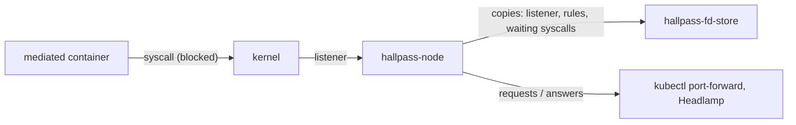

# Install and operate

## Install

Build the image and deploy it:

```
docker build -f deploy/kubernetes/Dockerfile -t <registry>/hallpass-node:<tag> .
docker push <registry>/hallpass-node:<tag>
(cd deploy/kubernetes && kustomize edit set image ghcr.io/alban/hallpass-node=<registry>/hallpass-node:<tag>)
kubectl apply -k deploy/kubernetes
```

This creates:

- the `HallpassPolicy` CRD (`hallpasspolicies.hallpass.io`, cluster-scoped);
- the namespace `hallpass-system`, with the `hallpass-node` DaemonSet,
  its service account and a cluster role reading namespaces and
  `hallpasspolicies`, and creating Events;
- the `hallpass-fd-store` DaemonSet: it keeps copies of the agent's
  seccomp file descriptors and session state, so the agent can restart
  without breaking the mediated containers. It has no Kubernetes access.

`hallpass-node` runs privileged with `hostPID`, mounts `/var/run/nri`
and `/run/hallpass` from the host, and uses the pod network: its
session API listens on the pod's loopback, `127.0.0.1:7323`, with no
authentication, so it is only reachable through `kubectl port-forward`
(see [Who can answer](answer.md#who-can-answer)).

## Startup and API server outages

The agent registers with NRI first, then refuses the opted-in
containers (they fail to start and the kubelet retries) until it has
read the namespaces and HallpassPolicies; it is Ready from then on
(`hallpass-node ready`, its readiness probe). If the API server becomes
unreachable later, mediation goes on with the last state read.

## Fail open

A container created while the agent is not running is not mediated. To
fail closed, enable the NRI default validator and list the plugin
(`hallpass`) in its `required_plugins`, or add the annotation
`required-plugins.noderesource.dev: '[hallpass]'` to the pod (also
checked by the default validator).

## Restarts and upgrades

!!! warning
    Experimental.

A mediated syscall blocks its thread until `hallpass-node` answers it,
through a seccomp listener file descriptor. `hallpass-fd-store` keeps
a copy of each listener, with the session's rules and the list of
syscalls waiting for an answer:



The kernel fails the waiting syscalls with `ENOSYS` only once every
copy of the listener is closed. So, on a node:

| You delete | Running mediated containers |
|---|---|
| the `hallpass-node` pod | keep running. The new agent takes their sessions over: rules kept, waiting requests asked again (new ids, new `askTimeout`). Containers starting meanwhile are not mediated (see [Fail open](#fail-open)). |
| the `hallpass-fd-store` pod | are not affected. The agent gives the new fd-store its copies again. |
| both pods | their mediated syscalls fail with `ENOSYS`, until the containers restart. In strict mode, the BPF programs are detached too. |

In strict mode, the fd-store also keeps the BPF programs: a new agent
adopts them, and the kernel enforces the sessions' rules throughout.
One gap: a `kubectl exec` whose first process has exited, leaving
children behind, is not taken over; its children's mediated syscalls
then fail with `ENOSYS`.

Both DaemonSets use `updateStrategy: OnDelete`: upgrade by deleting
their pods, one node at a time, and never both pods of a node at once:
delete one, wait until its replacement is Ready (and, after an
fd-store restart, until the agent logs `fd-store connected`), then the
other. With `--fd-store=""`, the agent runs without fd-store, and
deleting it is like deleting both.

## Strict mode

With `--mode=auto` (the default), the agent loads the BPF-LSM programs
at startup on nodes where `bpf` is in the active LSMs, and every
mediated container gets strict mode: the kernel enforces the answers on
the files it writes, as on a [workstation](../workstation/strict.md).
Elsewhere, it logs `lite mode` with the reason, and mediates in lite
mode. The policy does not choose the mode: the node does.

- `--mode=strict`: the agent fails to start without BPF-LSM, so no
  container is mediated in lite mode on that node (with [fail
  closed](#fail-open), opted-in containers fail to start, and the
  kubelet retries).
- `--mode=lite`: no BPF programs, for nodes where they are not wanted.

One set of programs serves all the node's containers: each container is
a session (a `kubectl exec` joins its container's session), and its
processes are tied to it from their first `execve`. Strict mode also
blocks the signals from mediated containers to the agent. The agent
logs `strict mode` at startup, and `strict=true` in each
`session started`.

As on a workstation, "allow once" needs a `sys_exit` tracepoint, which
slows down every syscall on the node a little (about 200 ns) while the
programs are loaded (see [Strict mode](../workstation/strict.md)).

## Agent flags

- `--mode` (default `auto`, or `strict`, `lite`): see
  [Strict mode](#strict-mode).
- `--namespace-selector` (default `hallpass.io/enabled=true`): the
  namespaces whose pods may opt in (see
  [Opt in](policies.md#opt-in)).
- `--fd-store` (default `/run/hallpass/fd-store.sock`): the fd-store
  socket, `""` to disable it.
- `--max-inflight` (default 1024): at most that many mediated syscalls
  wait per container or `exec` at a time; further ones wait in the
  kernel until one is answered.
- `--wait-killable` (default `auto`, or `true`, `false`): see
  [Requirements](index.md#requirements).
